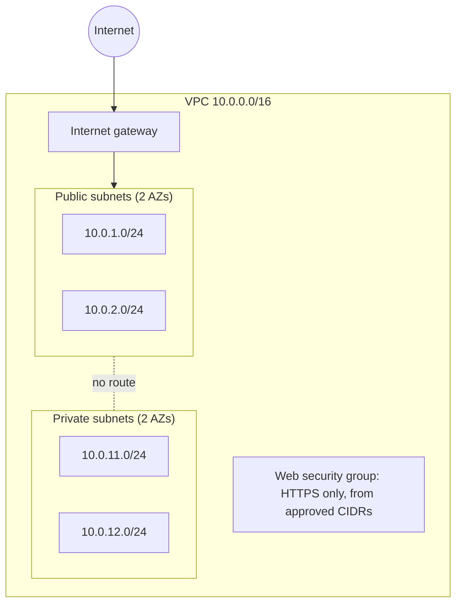

# terraform-aws-network

A small, reusable Terraform module that defines a minimal AWS network (VPC, public and private subnets, route tables, and a locked-down security group), plus a runnable example that uses it.

## Why I built it

To practise writing reusable infrastructure as code with sensible security defaults: no open inbound rules, no unnecessary billable resources, and everything validated before any cloud resource is created.

## Architecture



Public subnets route to the internet gateway. Private subnets have no internet route (there is deliberately no NAT gateway; see Limitations).

## What it demonstrates

- A reusable child module (`modules/vpc`) called by a root example (`examples/basic`)
- Pinned Terraform and provider versions, input validation, tags, and outputs
- Secure defaults: the VPC's default security group has no rules, and no inbound access exists unless `allowed_https_cidrs` is set

## Security and CI/CD

CI checks (formatting, validation, IaC scanning, secret scanning) are being added next. This section will be updated once the workflow is passing.

## Prerequisites

- Terraform 1.5 or later
- No AWS account is needed for validation

## Deploy or validate locally

```
cd examples/basic
terraform init
terraform validate
```

Deploying requires an AWS account and credentials. This repository has **not** been deployed to AWS.

## Verify

`terraform validate` should report: `Success! The configuration is valid.`

## Destroy and cost controls

The resources in this module (VPC, subnets, route tables, internet gateway, security groups) have no hourly charge by themselves. Check current AWS pricing before deploying, because costs and Free Tier terms can change. If you ever deploy it, run `terraform destroy` and confirm in the AWS console that nothing is left.

## Evidence / screenshots

- Validated locally with Terraform v1.16.6 and AWS provider v6.70.0: `terraform init` and `terraform validate` succeeded.
- No `plan` or `apply` against AWS has been run. This is local validation only.

## Limitations

- No NAT gateway, so private subnets have no outbound internet access (a NAT gateway is billed hourly)
- No VPC flow logs
- Availability zone names are derived from the region name, which may need adjusting for some accounts
- Learning project, not production-ready

## Lessons learned and next steps

- Add CI: `terraform fmt -check`, `validate`, an IaC scanner, and secret scanning
- Add a credential-free plan example
